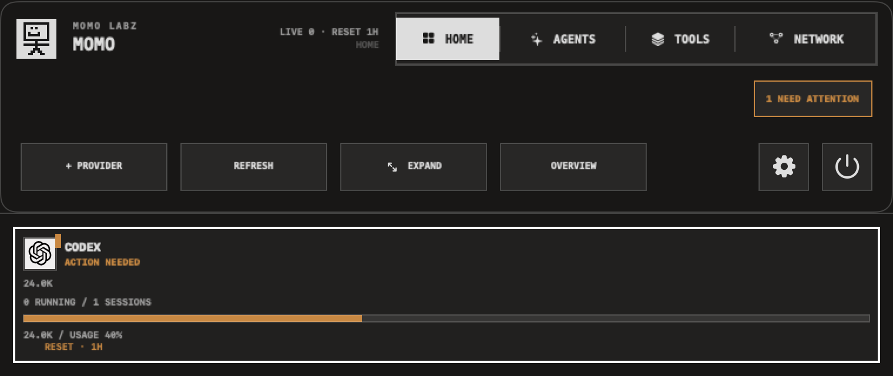
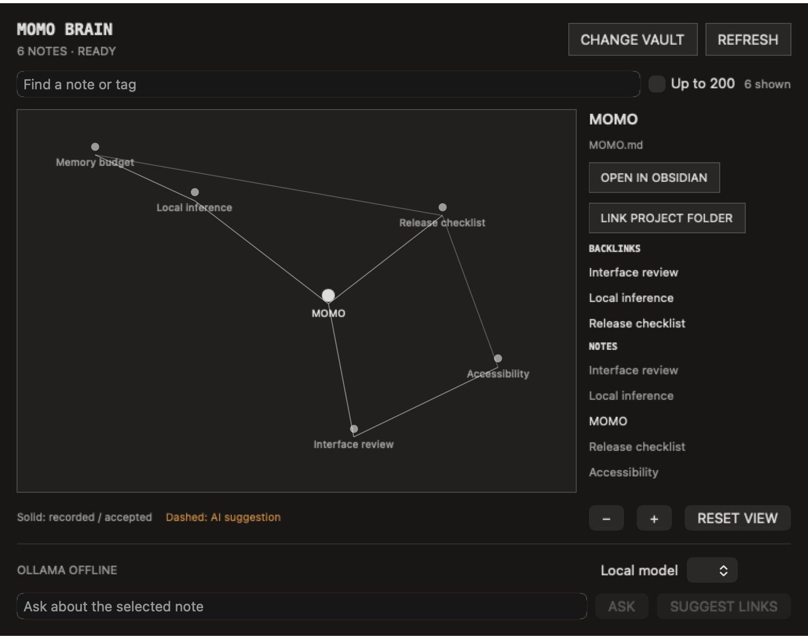

# MOMO

MOMO is a local-first macOS menu-bar monitor for recorded AI activity. It tracks supported Codex, Claude, Gemini, Cursor, and Grok sessions, reports verified usage observations, and optionally connects an Obsidian vault to a local Ollama model. It complements provider apps rather than replacing their chat interfaces.





These captures use synthetic sessions and notes, not live account usage.

## What works in 0.5

- A reusable status-item panel anchored to the right edge of the active screen. Clicking elsewhere leaves it open; the menu icon explicitly opens and closes it.
- A 700-point compact surface and 920-point expanded surface, wide enough to keep all five provider cards visible without horizontal scrolling.
- Expand grows the same top-right panel for Activity, Usage, or Brain. The 200 ms no-bounce transition is removed when Reduce Motion is enabled or navigation comes from the keyboard.
- Settings opens as a separate macOS popup window from the gear button, leaving the attached MOMO panel available underneath.
- A permanent provider strip showing recorded status, recent-session counts, verified usage provenance, and resets. Missing quota values remain unavailable rather than becoming invented percentages.
- Activity lists relevant recent sessions in groups of ten, supports debounced search, and opens read-only evidence. Open Original appears only for a verified destination.
- Usage separates local recorded tokens from account quota and supports isolated, explicit provider-page capture for Claude and Cursor.
- Brain provides an optional Obsidian-style graph with note search, backlinks, bounded graph display, project-folder mappings, and explicit open-in-Obsidian actions.
- An explicit Obsidian vault connection. MOMO reads Markdown metadata and links locally, skips hidden files and unsafe paths, indexes incrementally, and never writes without a Save confirmation.
- Brain suggestions from local Ollama are opt-in. Suggestions use dashed edges, cite the selected note, require review before acceptance, and can be saved as a new collision-safe note under `MOMO/`.
- Ollama model selection, offline/missing-model/loading/cancelled/timeout states, one active request at a time, bounded prompts and output, source-revision cache invalidation, and a five-minute answer cache. Local model checks are throttled to avoid recurring battery use.
- User-supplied Claude, Codex, Cursor, and Grok identity marks on consistent paper tiles, with a recognizable Gemini fallback.
- Restrained Momo entrance and tab motion that becomes instant when Reduce Motion is enabled.
- Local detection of active Codex, Claude Code, Gemini CLI, Cursor, and Grok processes.
- Relevant local history is bounded and paginated. This is not a full account-history import.
- Open provider processes are not counted as running chats. Per-chat live status depends on provider evidence; zero confirmed live chats does not establish that every provider is idle.
- Unchanged session files reuse cached summaries. Revoking a provider clears its cached session data; folder changes preserve independent drafts.
- Recent main-agent and subagent session summaries from local JSONL files.
- Provider-specific adapters, including synthetic public-schema Gemini and documented-schema Grok fixtures. Real-account Gemini/Grok validation remains pending.
- An attention view that separates approvals, failures, completed work, and recorded usage-limit events.
- Per-session provenance for model names, MCP servers, skills, and plugins when the local event log exposes them.
- An installed capability inventory sourced from enabled-provider configuration and shared skill folders, with separate `USED` marks derived from session receipts.
- A click-through inspector that shows the exact recorded capability set and return reason.
- Conservative `NEEDS YOU`, failed, completed, and last-recorded working states when local event data exposes them. Claude limit detection requires provider-owned error records; mentioning a limit in a prompt cannot trigger it.
- Optional macOS notifications for newly blocked or failed sessions.
- A deliberately short menu-bar mark: one icon plus at most one attention/activity count.
- Quick local token counts for session files that expose token metadata.
- One-click links to each provider’s official usage page.
- An opt-in, token-paired local Desk Display page designed for 480 × 320 screens.
- Hardened Desk Display pairing: a one-time query key becomes an HttpOnly same-site cookie, API clients use Bearer auth, foreign Host headers are rejected, sensitive titles can be redacted, and a busy port falls back safely.
- A buildable iOS 17 companion named **MOMO RELAY** that pairs with the Mac, polls the same read-only status feed, and raises foreground-detected return alerts.
- A truthful provider-access map: local visibility now, organization usage APIs where officially supported, and delegated OAuth only when providers expose it.
- A Raspberry Pi kiosk recipe plus printable body, back, and stand STL files under `Hardware/`.
- Compact menu-bar mode, idle-provider filtering, bounded local indexing, and macOS menu-bar cleanup guidance.
- No analytics or account-password collection. Brain sends selected note context only to local Ollama when requested; Desk Display is a separate opt-in local service.
- One shared versioned relay JSON contract compiled into both the Mac and iPhone targets.

## Build

Requirements: macOS 14+, Xcode 16+, and [XcodeGen](https://github.com/yonaskolb/XcodeGen).

```sh
xcodegen generate
xcodebuild -project BarBoy.xcodeproj -scheme BarBoy -configuration Release -derivedDataPath DerivedData build
xcodebuild -project BarBoy.xcodeproj -scheme BarBoyMobile -destination 'generic/platform=iOS Simulator' CODE_SIGNING_ALLOWED=NO build
# Fixture tests and Mac screenshots; no live account scan:
xcodebuild -project BarBoy.xcodeproj -scheme BarBoy -destination 'platform=macOS' BAR_BOY_RENDER_SNAPSHOTS=1 test
# Focused Brain/Ollama and visual checks:
xcodebuild -project BarBoy.xcodeproj -scheme BarBoy -destination 'platform=macOS' BAR_BOY_RENDER_SNAPSHOTS=1 -only-testing:BarBoyTests/BrainBackendTests -only-testing:BarBoyTests/BrainVisualTests test
```

The unsigned development Mac app is created at `DerivedData/Build/Products/Release/MOMO.app`. The iOS target is source/build verified but requires the Momo Labz Apple Developer Team before it can be installed on a physical iPhone or distributed through TestFlight.

## Download and install MOMO

For the current local build:

```sh
# Run from your checkout of this repository.
xcodegen generate
xcodebuild -project BarBoy.xcodeproj -scheme BarBoy -configuration Release -derivedDataPath DerivedData build CODE_SIGNING_ALLOWED=NO
open DerivedData/Build/Products/Release/MOMO.app
```

To place it in Applications, quit any older MOMO copy first, then drag `DerivedData/Build/Products/Release/MOMO.app` from Finder into `/Applications`. Launch MOMO from Applications and allow macOS to open the unsigned development build if Gatekeeper asks.

When a signed release is published, download the `.dmg`, open it, drag `MOMO.app` into `/Applications`, eject the mounted disk image, and launch MOMO from Applications. The current development build is unsigned and is not a notarized public download.

The real-data test prints aggregate counts and timings only. It never prints capability names, project paths, session titles, prompts, or transcript bodies. Snapshot fixtures are sanitized.

The September 13 packaged release was verified as a universal binary for Apple silicon and Intel Macs. The development app is not Apple-notarized; public distribution requires signing and notarization.

## Product truth

macOS has no supported public API that lets MOMO remove arbitrary third-party menu-bar items. Menu Calm opens Apple’s supported controls. Likewise, consumer subscription quota APIs are not consistently public, so unlinked short/week quota cells show an honest dash, official usage pages remain one click away, and local token counts are labeled as local.

OpenAI and Anthropic expose organization API usage endpoints using administrative credentials; those are different from personal ChatGPT and Claude subscription quotas. Version 0.4 maps those access paths but does not collect credentials or claim an account is connected. Remote MCP authorization is designed for OAuth 2.1 + PKCE and provider tokens belong in Keychain.

MOMO does not send provider messages or infer that an open provider process proves a particular chat is running. It reports only evidence present in authorized local records or explicitly accepted usage observations.

## Connect the Brain

1. Open **Brain → Connect vault** and select your Obsidian vault folder.
2. Select a note to inspect backlinks, open it in Obsidian, or explicitly link a project folder.
3. Start your separately installed Ollama server and load a model. Press **Refresh**, select a local model, then **Ask** or **Suggest links**.
4. Review suggestions. **Save to Obsidian** previews a new note; **Save** writes it under `MOMO/` without replacing an existing note.

Indexing is incremental on refresh. Metadata is bounded to 20,000 notes and the first 256 KiB per note; the graph defaults to 80 note nodes with an optional 200-node view. Large notes or vaults may therefore have incomplete links. Accepted suggestions remain session-local until saved. The 30-second model residency is a request to Ollama, not a measured guarantee of system memory release.

The Obsidian Brain is read-only until the user confirms a save. It stores a security-scoped vault bookmark locally, keeps note bodies out of the graph index, and caps visible graph nodes at 80 by default or 200 after an explicit expansion. Ollama is loopback-only and is never downloaded or started by MOMO.

## Strong next additions

1. Provider-supported organization usage adapters with credentials stored in Keychain.
2. An opt-in encrypted relay + APNs so iPhone alerts and response handoff work away from the Mac's local network.
3. Live-device verification of menu shortcuts and notifications.
4. A trust ladder for actions: suggest → prepare → confirm → execute, plus per-action allowlists and an audit log.
5. Click a blocked return to focus and answer the exact terminal/editor/task.
6. Git branch/worktree, tests, PR status, and concrete outcome context beside each agent.
7. A signed, notarized DMG, TestFlight build, Sparkle updates, and `SMAppService` launch at login.

## Privacy

See [PRIVACY.md](PRIVACY.md). The Desk Display server is off by default and stays on the local network when enabled.
