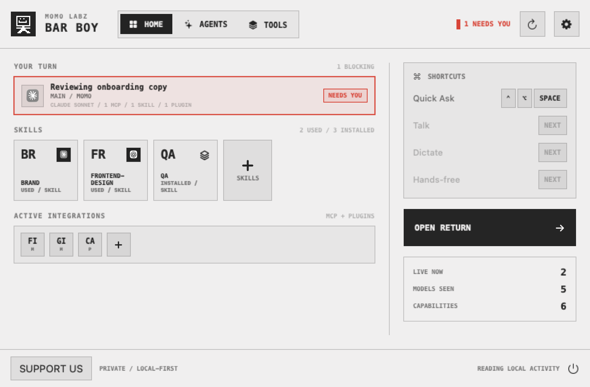

# BAR BOY

BAR BOY is a working title for a private, local-first Momo Labz return queue. It keeps Codex, Claude, Gemini, Cursor, and Grok moving by gathering every question, approval, failure, and completed result in one place instead of making the human patrol five apps.

<picture>
  <source media="(prefers-color-scheme: dark)" srcset="Docs/barboy-dark.png">
  
</picture>

## What works in 0.4

- A compact models-only `MenuBarExtra` that expands into a resizable horizontal command window.
- Three focused tabs: Home for returns and shortcuts, Agents for model/session activity, and Tools for MCP, plugin, and skill provenance.
- Recognizable provider marks sourced from installed apps when available, rendered in the monochrome Momo Labz system.
- Restrained Momo entrance and tab motion that becomes instant when Reduce Motion is enabled.
- Local detection of active Codex, Claude Code, Gemini CLI, Cursor, and Grok processes.
- Recent main-agent and subagent session summaries from local JSONL files.
- Provider-specific Claude, Codex, and Cursor adapters that read their actual local schemas; Gemini and Grok retain conservative generic discovery until fixtures exist.
- A priority `YOUR TURN` queue that separates human-blocked work from agents still moving.
- Per-session provenance for model names, MCP servers, skills, and plugins when the local event log exposes them.
- An installed capability inventory sourced from enabled-provider configuration and shared skill folders, with separate `USED` marks derived from session receipts.
- A click-through inspector that shows the exact recorded capability set and return reason.
- Conservative `NEEDS YOU`, failed, completed, working, and idle states when local event data exposes them.
- Optional macOS notifications for newly blocked or failed sessions.
- A deliberately short menu-bar mark: one icon plus at most one attention/activity count.
- Quick local token counts for session files that expose token metadata.
- One-click links to each provider’s official usage page.
- A global **Control–Option–Space** Quick Ask palette that routes a copied prompt to any supported provider.
- An opt-in, token-paired local Desk Display page designed for 480 × 320 screens.
- Hardened Desk Display pairing: a one-time query key becomes an HttpOnly same-site cookie, API clients use Bearer auth, foreign Host headers are rejected, sensitive titles can be redacted, and a busy port falls back safely.
- A buildable iOS 17 companion named **MOMO RELAY** with matching Home, Agents, and Tools tabs; it pairs with the Mac, polls the same read-only status feed, and raises foreground-detected return alerts.
- A truthful provider-access map: local visibility now, organization usage APIs where officially supported, and delegated OAuth only when providers expose it.
- A Raspberry Pi kiosk recipe plus printable body, back, and stand STL files under `Hardware/`.
- Compact menu-bar mode, idle-provider filtering, and macOS menu-bar cleanup guidance.
- No analytics, backend, prompt upload, or account-password collection.
- One shared versioned relay JSON contract compiled into both the Mac and iPhone targets.

## Build

Requirements: macOS 14+, Xcode 16+, and [XcodeGen](https://github.com/yonaskolb/XcodeGen).

```sh
xcodegen generate
xcodebuild -project BarBoy.xcodeproj -scheme BarBoy -configuration Release -derivedDataPath DerivedData build
xcodebuild -project BarBoy.xcodeproj -scheme BarBoyMobile -destination 'generic/platform=iOS Simulator' CODE_SIGNING_ALLOWED=NO build
# Optional release verification gates:
xcodebuild -project BarBoy.xcodeproj -scheme BarBoy -destination 'platform=macOS' BAR_BOY_REAL_DATA_CHECK=1 BAR_BOY_RENDER_SNAPSHOTS=1 test
```

The unsigned development Mac app is created at `DerivedData/Build/Products/Release/BAR BOY.app`. The iOS target is source/build verified but requires the Momo Labz Apple Developer Team before it can be installed on a physical iPhone or distributed through TestFlight.

The real-data test prints aggregate counts and timings only. It never prints capability names, project paths, session titles, prompts, or transcript bodies. Snapshot fixtures are sanitized.

Release builds are universal binaries for Apple silicon and Intel Macs. The development DMG is ad-hoc signed but not Apple-notarized; a public download should be signed with the Momo Labz Developer ID and notarized first.

## Product truth

macOS has no supported public API that lets BAR BOY remove arbitrary third-party menu-bar items. Menu Calm opens Apple’s supported controls. Likewise, consumer subscription quota APIs are not consistently public, so unlinked short/week quota cells show an honest dash, official usage pages remain one click away, and local token counts are labeled as local.

OpenAI and Anthropic expose organization API usage endpoints using administrative credentials; those are different from personal ChatGPT and Claude subscription quotas. Version 0.4 maps those access paths but does not collect credentials or claim an account is connected. Remote MCP authorization is designed for OAuth 2.1 + PKCE and provider tokens belong in Keychain.

Quick Ask currently copies the request and opens the chosen provider; it does not secretly inject keystrokes or execute an AI action. Voice capture and delegated actions stay visibly marked as next-stage features until their permission and confirmation model is complete.

## Strong next additions

1. Provider-supported organization usage adapters with credentials stored in Keychain.
2. An opt-in encrypted relay + APNs so iPhone alerts and response handoff work away from the Mac's local network.
3. Speech-to-text Talk, Dictate, and Hands-free modes with contextual microphone permission.
4. A trust ladder for actions: suggest → prepare → confirm → execute, plus per-action allowlists and an audit log.
5. Click a blocked return to focus and answer the exact terminal/editor/task.
6. Git branch/worktree, tests, PR status, and concrete outcome context beside each agent.
7. A signed, notarized DMG, TestFlight build, Sparkle updates, and `SMAppService` launch at login.

## Privacy

See [PRIVACY.md](PRIVACY.md). The Desk Display server is off by default and stays on the local network when enabled.
